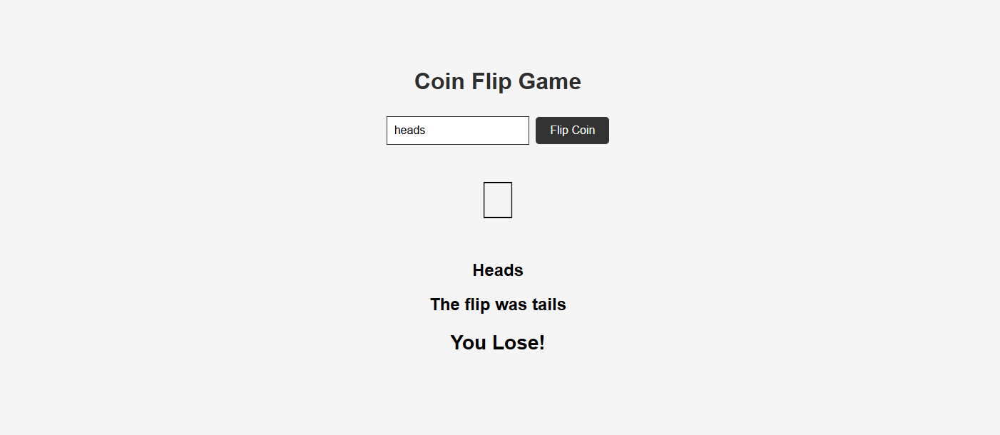

# Coin Flip Game

An interactive coin-flipping game built with HTML, CSS, JavaScript, and Node.js.

Players predict heads or tails, flip a virtual coin, and find out whether they won or lost. The application uses a custom Node.js HTTP server to generate randomized results and return them to the frontend.

## Live Demo

**[Play Coin Flip Game](https://coin-flip-evco.onrender.com/)**

## Technologies


## Features

- Predict heads or tails before flipping a coin
- Generate randomized results using a Node.js backend
- Display the player's prediction and actual coin-flip result
- Determine whether the player won or lost
- Animate the coin when flipping
- Update results dynamically without refreshing the page
- Communicate with the backend through the Fetch API

## Screenshot



## How It Works

1. Enter `heads` or `tails` in the input field.
2. Click **Flip Coin**.
3. The frontend sends the player's prediction to the Node.js server.
4. The server randomly selects heads or tails.
5. The backend compares the result against the player's prediction.
6. The game displays the outcome and whether the player won or lost.

## API Endpoint

### GET /api

Generates a random coin-flip result and compares it with the player's prediction.

**Example request:**

```http
GET /api?input=heads
```

**Example response:**

```json
{
  "yourChoice": "Heads",
  "flipResult": "The flip was tails",
  "winOrLose": "You Lose!"
}
```

The response varies because the coin-flip result is randomly generated.

## Getting Started

### 1. Clone the Repository

```bash
git clone https://github.com/AnwarAlshohatee/coin-flip.git
cd coin-flip
```

### 2. Install Dependencies

Requires Node.js and npm.

```bash
npm install
```

### 3. Start the Application

```bash
npm start
```

Open the application in your browser:

```text
http://localhost:8000
```

## Future Improvements

- Add dedicated buttons for heads and tails
- Track wins and losses with a scoreboard
- Add input validation and error handling
- Improve the coin-flip animation
- Add sound effects and additional visual feedback
- Improve mobile responsiveness

## Author

**Anwar Alshohatee**

[Portfolio](https://anwaralshohatee.netlify.app) | [LinkedIn](https://www.linkedin.com/in/anwaralshohatee/)
